# Pulse: Digital Wellbeing for PC

_Android-style Digital Wellbeing for your PC — calm, private and 100% on-device._

**Website:** [digitalwellbeingpc.com](https://www.digitalwellbeingpc.com)

[](LICENSE)
[](https://dotnet.microsoft.com/)
[](https://www.microsoft.com/windows)
[](https://github.com/swarajdhondge/digitalwellbeingpc/releases)
[](https://github.com/swarajdhondge/digitalwellbeingpc/releases)

**Pulse** brings the Android Digital Wellbeing experience to your PC: track your screen time, see which apps eat your hours, set app limits, run focus sessions and protect your hearing, in a calm, redesigned interface. No account, no cloud, no telemetry. Every byte stays on your PC.

<p align="center">
  <!-- Committed at .github/demo/demo.gif (regenerated by scripts/record-demo.ps1). Don't use a
       release-asset URL: release assets download as attachments and won't render inline. -->
  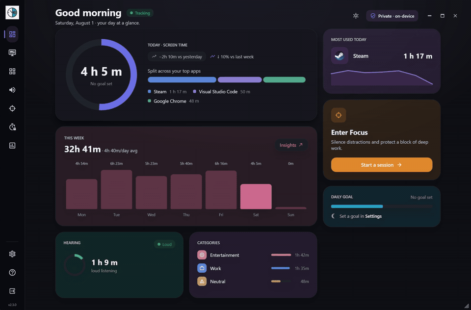
</p>

---

## Features

- **Screen time:** today, this week and past weeks. Pauses after 5 minutes away unless you're watching or listening.
- **App usage:** top apps by time, with app switches and average focus.
- **App limits:** a daily allowance or off-limits hours per app. Pulse reminds you as often as you choose, or minimizes the app.
- **Focus sessions:** 15 to 90 minutes or custom. Warn mode nudges you; Block mode minimizes distractions.
- **Breaks and wind down:** 20-20-20 eye-break reminders and quiet hours with a soft screen glow.
- **Hearing protection:** estimates listening level from system volume and flags time above 75 dB. Never records audio.
- **Goals and insights:** a daily screen-time goal and a weekly report with week-over-week trends.
- **Command line:** `pulse today`, `pulse week` and `pulse apps` in any terminal.
- **Your data:** CSV export, backup and restore, delete any date range.
- **Your language:** English plus 13 translations\*, following Windows or chosen in Settings.
  <br><sub>\* Translated with AI assistance. [Report a translation issue](https://github.com/swarajdhondge/digitalwellbeingpc/issues/new?template=translation.yml) or see [CONTRIBUTING.md](CONTRIBUTING.md#translations).</sub>

<p align="center">
  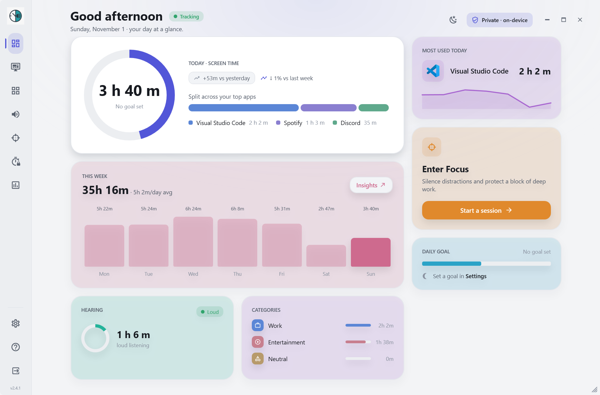
  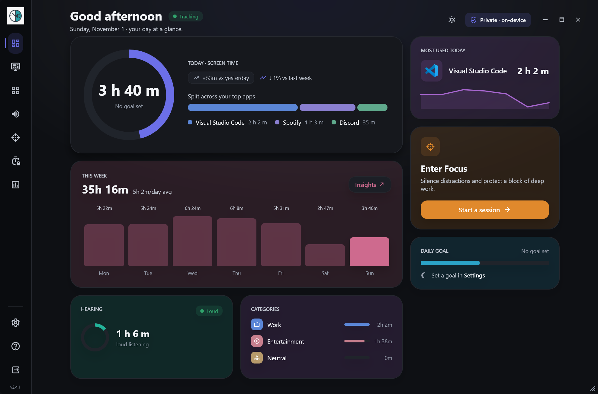
</p>

<details>
<summary>More screenshots</summary>

<p align="center">
  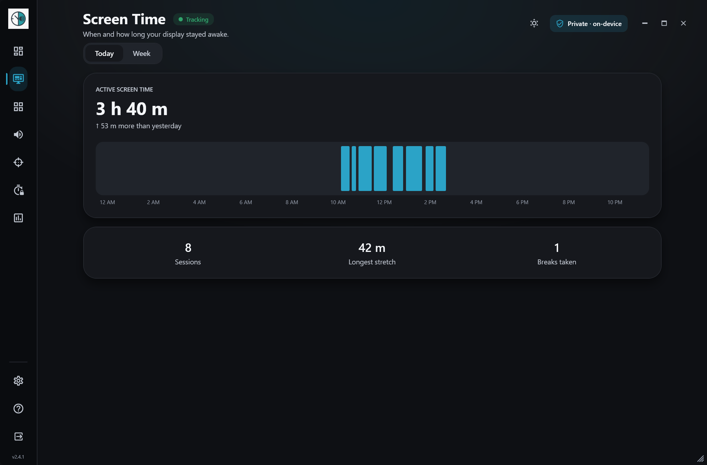
  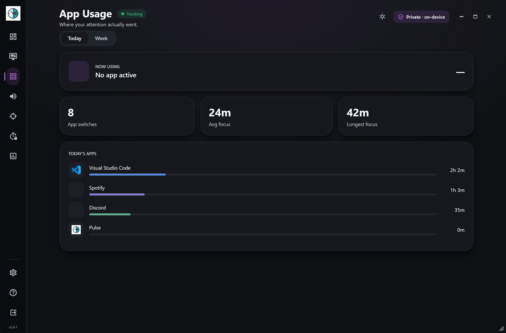
  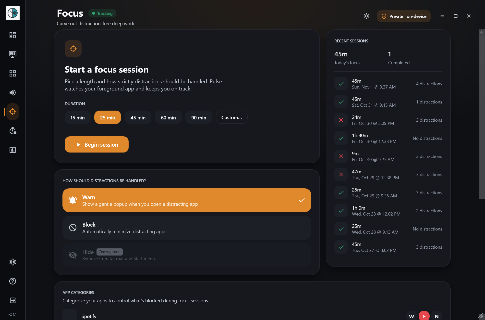
  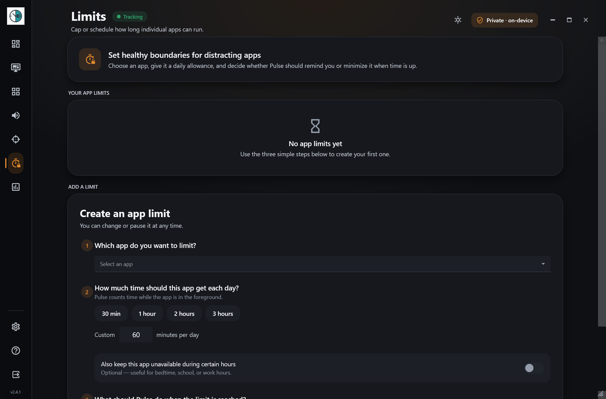
  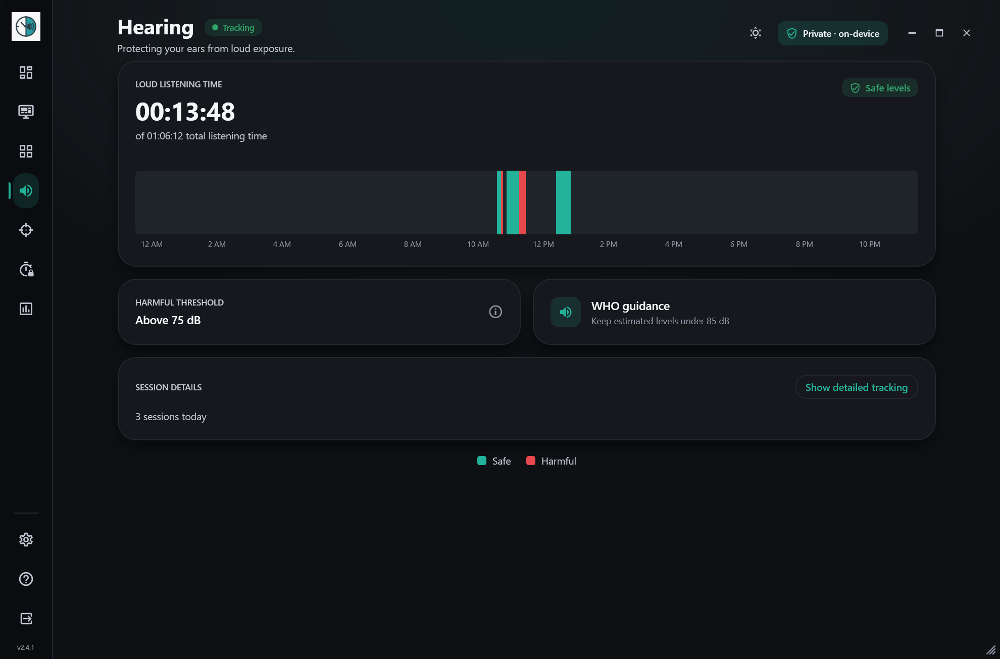
  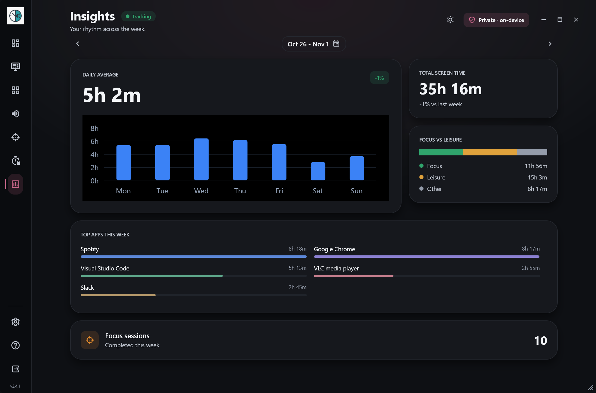
  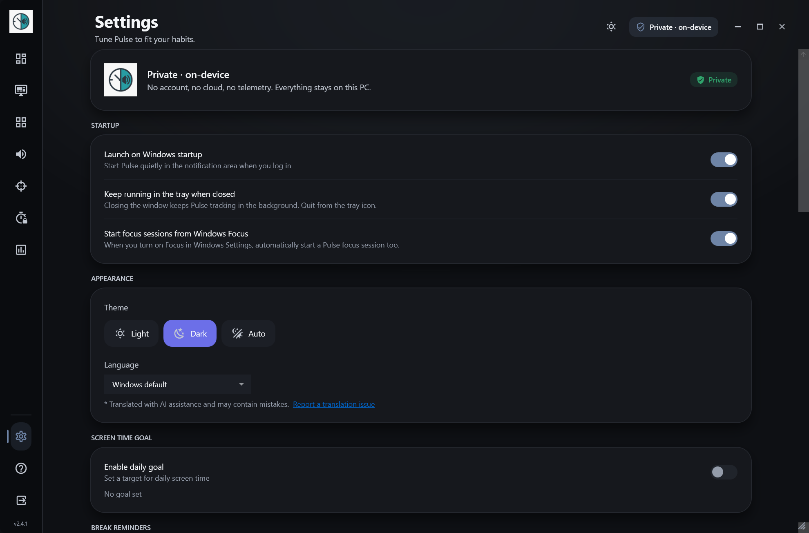
</p>
</details>

---

## Install

<a href="https://apps.microsoft.com/detail/9ND5GNMBQVQ7">
  
</a>

The [Microsoft Store](https://apps.microsoft.com/detail/9ND5GNMBQVQ7) version is signed by Microsoft and updates itself. Or download `Setup.exe` from the [latest release](https://github.com/swarajdhondge/digitalwellbeingpc/releases): no admin rights needed, .NET included, automatic updates.

> [!NOTE]
> `Setup.exe` isn't code-signed yet, so Windows may say **"Windows protected your PC"** the first time. Click **More info → Run anyway**, or use the Store version. Each release includes `SHA256SUMS.txt` to verify the download.

## Command line

Both installers add a `pulse` command. Open a new terminal:

```text
pulse today    today's screen time and top apps
pulse week     this week, compared with last week
pulse apps     top apps (--week, -n 5)
pulse start    start Pulse in the background (pulse stop to quit)
```

`pulse help` lists everything. It reads what Pulse records, in the app's language.

<p align="center">
  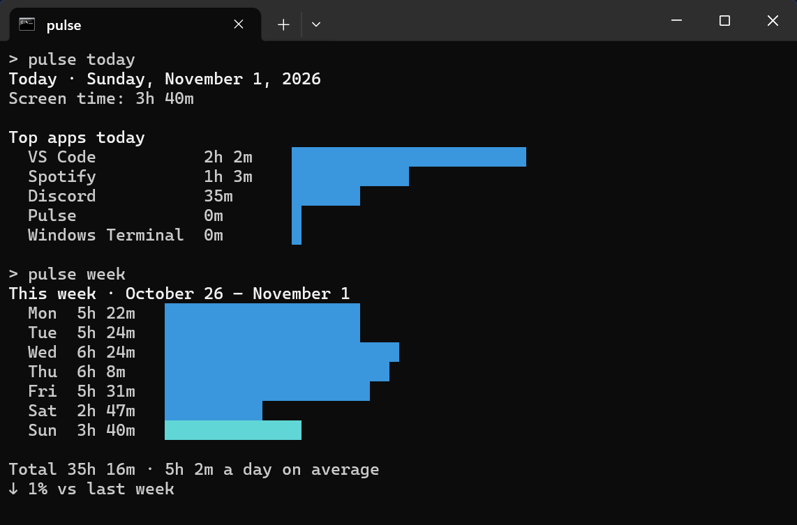
</p>

## Build from source

```bash
git clone https://github.com/swarajdhondge/digitalwellbeingpc.git
cd digitalwellbeingpc
dotnet run --project digital-wellbeing-app
```

Needs the [.NET 9 SDK](https://dotnet.microsoft.com/download/dotnet/9.0) and Windows 10 or 11.

---

Built with WPF, .NET 9, SQLite, LiveCharts2, NAudio and [Velopack](https://velopack.io). Contributions are welcome: see [CONTRIBUTING.md](CONTRIBUTING.md) and the [issues](https://github.com/swarajdhondge/digitalwellbeingpc/issues).

GPL-3.0 © 2026 Swaraj Dhondge. Free software with no warranty; see [LICENSE](LICENSE), [third-party notices](THIRD-PARTY-NOTICES.md) and [privacy](PRIVACY.md).
